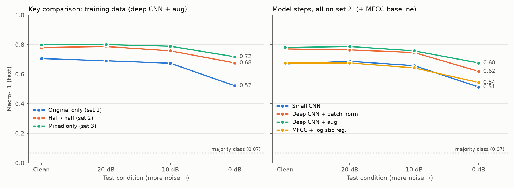
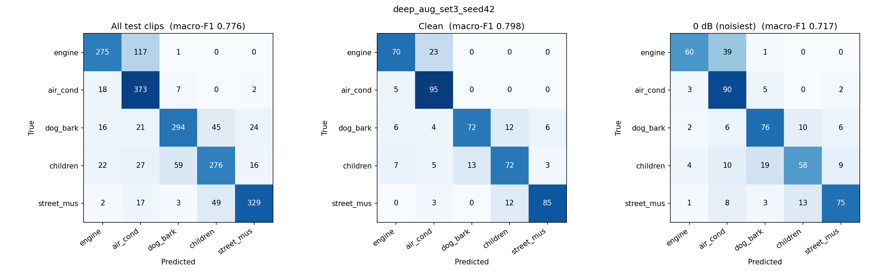
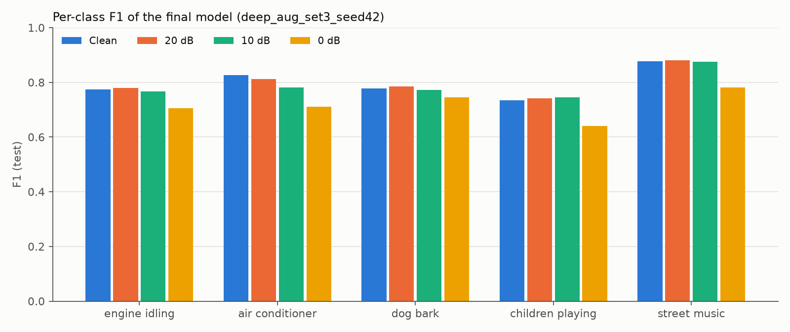
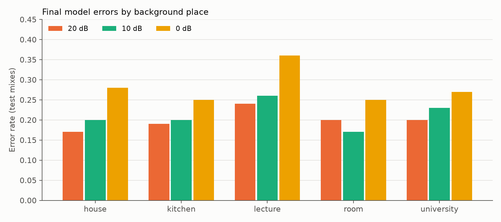

# Results

All scores are macro-F1 (the average of the five per-class F1 scores) on the same test set:
UrbanSound8K fold 10, 493 clean clips plus each of 500 events mixed with our own background
recordings at 20, 10 and 0 dB signal-to-noise (1,993 clips). Fold 9 was used for every choice
(epochs, settings, final model, "not sure" threshold); the test set was used only to report.

## 1. Experiment table

| Model | Training data | Clean | 20 dB | 10 dB | 0 dB | Overall |
|---|---|---|---|---|---|---|
| Majority class | any | 0.06 | 0.07 | 0.07 | 0.07 | 0.07 |
| MFCC + logistic regression | original only | 0.67 | 0.67 | 0.63 | 0.53 | 0.62 |
| MFCC + logistic regression | half / half | 0.67 | 0.68 | 0.64 | 0.54 | 0.63 |
| MFCC + logistic regression | mixed only | 0.66 | 0.67 | 0.65 | 0.56 | 0.63 |
| Small CNN | half / half | 0.67 | 0.69 | 0.66 | 0.51 | 0.63 |
| Deep CNN + batch norm | half / half | 0.77 | 0.76 | 0.75 | 0.62 | 0.72 |
| Deep CNN + augmentation | original only | 0.70 | 0.69 | 0.67 | 0.52 | 0.65 |
| Deep CNN + augmentation | half / half | 0.78 | 0.79 | 0.76 | 0.68 | 0.75 |
| **Deep CNN + augmentation (final)** | **mixed only** | **0.80** | **0.80** | **0.79** | **0.72** | **0.78** |

Because there is one training run per configuration, each difference below was checked with a paired
bootstrap over the 493 test events (2,000 resamples; the clean clip and its three mixes are resampled
together, since they are the same event). "Clear" means the 95% interval excludes zero.

| Comparison | Difference in macro-F1 | 95% interval | |
|---|---|---|---|
| Mixed only vs original only | +0.126 | 0.099 – 0.154 | clear |
| Half / half vs original only | +0.100 | 0.073 – 0.129 | clear |
| Mixed only vs half / half | +0.026 | 0.004 – 0.049 | clear, small |
| … clean clips only, mixed only vs half / half | +0.018 | −0.009 – 0.046 | not clear |
| … 0 dB only, mixed only vs original only | +0.196 | 0.156 – 0.240 | clear |
| Augmentation (deep, half / half) | +0.025 | 0.001 – 0.051 | clear, small |
| Deep + batch norm vs small CNN | +0.094 | 0.063 – 0.126 | clear |
| Final CNN vs MFCC baseline (both mixed only) | +0.142 | 0.103 – 0.184 | clear |
| CNN vs MFCC baseline, both original only | +0.026 | −0.014 – 0.063 | not clear |

## 2. What the experiments show

- **Training on mixed audio is the main result.** With the same model and the same source events,
  training on mixes instead of clean clips raises overall macro-F1 from 0.65 to 0.78, and at 0 dB from
  0.52 to 0.72. It also does not hurt clean clips: mixed-only is 0.80 on clean audio versus 0.70 for
  original-only. Half / half sits in between, closer to mixed-only.
- **Noise robustness.** Every model loses accuracy as noise rises (a sanity check that the noise levels
  are real). The final model loses only 0.08 from clean to 0 dB; the original-only model loses 0.18.
- **Model steps.** Going deeper with batch norm adds about 0.09; augmentation adds a further 0.03.
  The small CNN was still improving when it hit the 50-epoch limit, so its score is a lower bound.
- **Baselines.** The majority class scores 0.07, so every model has clearly learned something.
  The MFCC baseline (0.62–0.63) is as good as the small CNN. A CNN trained only on clean clips is not
  clearly better than it; the large gain only appears when the CNN is trained on noisy mixes.

## 3. Final model

**Deep CNN + augmentation trained on mixed audio (`runs/deep_aug_set3_seed42`)**, chosen because it has
the best validation macro-F1 (0.745; the next best was 0.729). On test it is also best in every
condition: 0.80 clean, 0.80 at 20 dB, 0.79 at 10 dB, 0.72 at 0 dB, 0.78 overall (77.6% accuracy).

## 4. Confusion matrix

Street music is the easiest class (F1 0.85 overall) and children playing the hardest (0.72).

## 5. Error analysis

The final model makes 446 mistakes on 1,993 test clips.

**1. Engine idling is heard as air conditioner** (117 errors, 26% of all mistakes). Both are steady,
low-pitched hums with little structure over time, so a 2 s log-mel picture of them looks alike. It is
the largest error at every noise level and grows with noise (23 clean → 39 at 0 dB), because the
background hum of a room covers the small differences between the two. The reverse error is rare
(18), so the model leans towards "air conditioner" whenever it hears a hum.

**2. Children playing, dog bark and street music are mixed up** (children → dog 59, street music →
children 49, dog → children 45). All three are short, loud events with voices or harmonics in the same
frequency range, and many UrbanSound8K clips of one class contain the others in the background
(children shouting near a barking dog, music in a street with children).

**3. Background events are much harder.** UrbanSound8K marks each clip as foreground or background
sound. On clean test clips the final model is right on 85.5% of foreground clips but only 68.5% of
background clips: when the labelled sound is faint, other sounds in the recording win.

**4. Noise mostly breaks the same weak pairs.** Of the 493 events, 52 are right when clean and wrong
at 0 dB; 16 of them are engine idling turning into air conditioner. Noise does not create new kinds of
mistakes, it pushes borderline clips over the edge.

**5. Background place.** Error rate on mixes per place: lecture 29%, university 23%, house 22%,
kitchen 21%, room 21%. Lecture speech is the hardest background, probably because voices overlap with
children playing and street music. The room recording has a steady fan hum; it does not cause more
errors overall, but 60% of its errors are "air conditioner" answers (34–46% for the other places), which
fits the fan being mistaken for the class.

**6. Confidence.** The model is less sure when it is wrong (mean confidence 0.71 vs 0.89 when right),
which is what makes a "not sure" answer useful. But 104 mistakes still have confidence ≥ 0.9: 41 are
engine idling → air conditioner and 34 are dog barks. They come from only 44 test events, and 38 of
those events are wrong in all four versions (clean, 20, 10, 0 dB), so these are problems with the event
itself rather than with noise: a hum that truly sounds like an air conditioner, or a clip where another
sound is louder than the labelled one. The 25 most confident are listed in
`runs/analysis/confident_errors.csv` for blind listening.

**Blind listening of these 25 clips** (I choose one of the five classes or "unclear" without
seeing the label or the prediction; results in `runs/analysis/blind_listening.csv`):

| What I heard | Clips |
|---|---|
| The labelled class (a real model mistake) | 9 |
| The class the model predicted | 8 |
| Both the labelled and the predicted sound | 1 |
| Unclear | 7 |

So in 16 of the 25 most confident mistakes, a human could not confirm the label either. All 9 clips whose
labelled sound UrbanSound8K marks as *background* fall in this group: none was heard as the label. For
example, `77927` (labelled dog bark) was heard as street music in four of its five versions, which is what
the model said. Of the 9 real model mistakes, 4 are engine idling heard as air conditioner at 0 dB, and
I also found these two classes hard to tell apart. This supports points 1 and 3 above: part of the
error comes from labels describing faint background sounds, and part from two classes that sound alike.

**"Not sure" threshold.** The threshold is chosen on validation and only measured here:

| Threshold | Clips answered (test) | Accuracy when answered | Answered at 0 dB |
|---|---|---|---|
| none | 100% | 77.6% | 100% |
| 0.6 (current `threshold.json`) | 85.7% | 82.7% | 79.4% |
| 0.9 | 58.0% | 91.0% | 42.0% |

The model says "not sure" more often on noisy clips, which is the intended behaviour.

